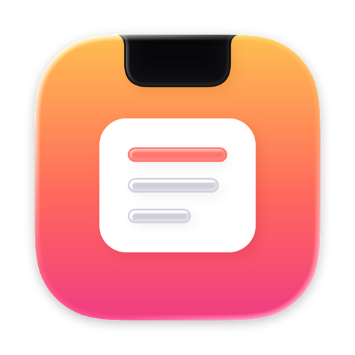
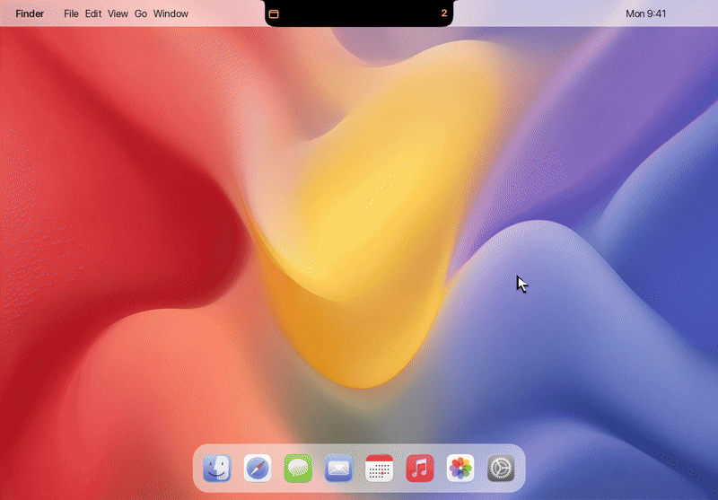
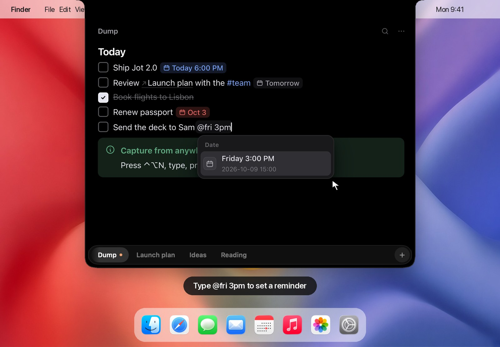

<p align="center">
  
</p>

<h1 align="center">Jot</h1>

<p align="center">
  <strong>A Notion-style editor that lives in your Mac's notch.</strong><br>
  Push the pointer up, write, move away. Every note is a Markdown file you own.
</p>

<p align="center">
  <a href="#install">Install</a>&nbsp;·&nbsp;
  <a href="#how-it-works">How it works</a>&nbsp;·&nbsp;
  <a href="#shortcuts">Shortcuts</a>&nbsp;·&nbsp;
  <a href="#your-notes-are-files">Your notes</a>&nbsp;·&nbsp;
  <a href="CONTRIBUTING.md">Contribute</a>
</p>

<p align="center">
  
</p>

Jot is for the thought you'd otherwise Slack to yourself. It has no Dock icon and no window to find. It hangs from the notch: touch it and a full editor drops down, move away and it tucks back in.

It's quick like a sticky note, but you can do real writing in it: to-dos with reminders, headings that fold, toggles, callouts, code, images, links between notes. Everything is saved as plain `.md` files in a folder you pick, so Obsidian, git and iCloud Drive work on your notes as they are.

**macOS 15+ · Apple Silicon & Intel · free and open source ([MIT](LICENSE))**

## Install

1. Download `Jot.dmg` (or `Jot.zip`) from [**Releases**](../../releases/latest).
2. Drag **Jot** to Applications and open it.
3. Touch the notch.

Signed releases update themselves. To start Jot at login, open Settings (<kbd>⌘,</kbd>) and turn on **Open at login**.

<details>
<summary>Homebrew, or a build that macOS won't open</summary>

```bash
brew install --cask skdev24/jot/jot
```

If you built Jot yourself or downloaded an unsigned build, macOS asks before the first launch. Right-click Jot → **Open**, or run:

```bash
xattr -cr /Applications/Jot.app
```
</details>

## How it works



**Write like in Notion.** Type `/` for any block: to-do, heading, list, toggle, quote, callout, code, divider, image. Hover a line to get a **⋮⋮** handle: drag it to move the block, or click it to duplicate, recolor, delete or turn the block into something else. Select text for formatting, links and Notion's nine colors. Markdown shortcuts work as you type, and each note keeps its own undo history, even after the island closes.

**Get a nudge when it matters.** In a to-do, type `@` and a date: `@today`, `@fri 3pm`, `@in 2 weeks`, `@oct 12`. It becomes a chip (blue for today, red once it's overdue), and macOS reminds you on time. While something is due, the closed notch shows how many.

**Capture without stopping.** <kbd>⌃⌥N</kbd> from any app opens Dump with the caret on a fresh line. Select text anywhere and choose **Services → Send to Jot**. Drag text, a link, an image or a file onto the notch, and the island opens to take it.

**Find anything.** <kbd>⌘P</kbd> searches every note at once, by title or by text. Type `#tag` to see everything tagged, or a new title to make a note. `[[` links one note to another, and if the note doesn't exist yet, clicking the link creates it.

**Tabs that behave.** Click to switch and the highlight slides across. Drag a tab to reorder. Double-click to rename, which renames the file too. Right-click for the rest.

## Shortcuts

| Anywhere | |
| --- | --- |
| Push the pointer into the notch | Open. It closes when you move away, unless you're typing |
| <kbd>⌃⌥Space</kbd> | Open or close |
| <kbd>⌃⌥N</kbd> | Capture to Dump |

| In Jot | |
| --- | --- |
| <kbd>⌘P</kbd> | Search notes, jump to one, filter by `#tag`, create a note |
| <kbd>⌘N</kbd> · <kbd>⌘,</kbd> | New note · Settings |
| <kbd>⌘1</kbd>…<kbd>⌘9</kbd> · <kbd>⌃Tab</kbd> | Go to a tab · next tab (<kbd>⌃⇧Tab</kbd> for the previous one) |
| <kbd>Esc</kbd> | Close a menu, then the island |
| `/` · `@` · `[[` · `#` | Blocks · dates · note links · tags |
| <kbd>⌘↵</kbd> | Tick a to-do (or make the line one) |
| <kbd>⌘⇧↑</kbd> <kbd>⌘⇧↓</kbd> · <kbd>⌘D</kbd> | Move the block · duplicate it |
| <kbd>⌘K</kbd> | Add a link. <kbd>⌘</kbd>-click a link to open it |
| <kbd>⌘⇧V</kbd> | Paste as plain text, in the style around the caret |
| <kbd>⌘F</kbd> · <kbd>⌘⇧C</kbd> | Find in the note · copy the note as Markdown |
| <kbd>Tab</kbd> · <kbd>⇧Tab</kbd> | Indent or outdent a list item |

Markdown works as you type: `#` `##` `###` for headings, `-`, `1.`, `[]` for lists and to-dos, `>` for quotes, `> [!tip]` for a callout, ` ``` ` for code, `---` for a divider, and `**bold**`, `*italic*`, `` `code` ``, `~~strike~~`, `==highlight==`. Paste Markdown and it turns into blocks. Copy from Jot and you get Markdown back.

## Your notes are files

```
~/Documents/Jot/          (or any folder: Settings → Notes)
├── Dump.md               one file per tab
├── Launch plan.md
├── assets/               pasted and dropped images
└── .jot/                 tab order, folded headings, and the last 30 backups
```

Edit a note in Obsidian, VS Code, or anything else, and Jot shows the change. New `.md` files in the folder appear as tabs. Notes you delete in Jot go to the Trash.

Jot writes ordinary Markdown. Where Markdown has no syntax for something, it uses forms other tools already read:

| In Jot | In the file |
| --- | --- |
| To-do with a reminder | `- [ ] Send the deck 📅 2026-10-09 15:00` (Obsidian Tasks format) |
| Callout | `> [!tip] Title` (Obsidian callouts) |
| Toggle | `<details><summary>Title</summary> … </details>` |
| Note link | `[[Launch plan]]` |
| Image with a width | `` |
| Text color · highlight | `<span data-color="red">…</span>` · `==…==` or `<mark data-color="blue">…</mark>` |
| Underline | `<u>…</u>` |

**Coming from Jot 1.x?** On first launch your notes are converted to `.md` files, and the old files are moved to `.jot/legacy/`. Nothing is deleted.

## Privacy

Jot has no account, no analytics, and no server. The only network request it makes is the update check, which you can turn off in Settings. Your notes stay in the folder you chose.

## Build from source

You need Xcode 26 or later. The built editor (`Jot/Editor/Web/`) is committed, so Node is only needed if you change the editor.

```bash
git clone https://github.com/skdev24/jot.git && cd jot
open Jot.xcodeproj          # run the “Jot” scheme
xcodebuild -project Jot.xcodeproj -scheme Jot -configuration Release \
  -derivedDataPath build/derived CODE_SIGN_IDENTITY=- build
```

- [CONTRIBUTING.md](CONTRIBUTING.md): setup, the project layout, the editor dev loop, tests.
- [docs/ARCHITECTURE.md](docs/ARCHITECTURE.md): how the Swift app and the web editor fit together.
- [docs/RELEASING.md](docs/RELEASING.md): signed, notarized releases and updates.

## Thanks

Jot is built on [TipTap](https://tiptap.dev) and [ProseMirror](https://prosemirror.net) (the editor), [lowlight](https://github.com/wooorm/lowlight) (code highlighting), [chrono](https://github.com/wanasit/chrono) (reading dates), [Floating UI](https://floating-ui.com), [Sparkle](https://sparkle-project.org) (updates) and [KeyboardShortcuts](https://github.com/sindresorhus/KeyboardShortcuts). All MIT licensed.
